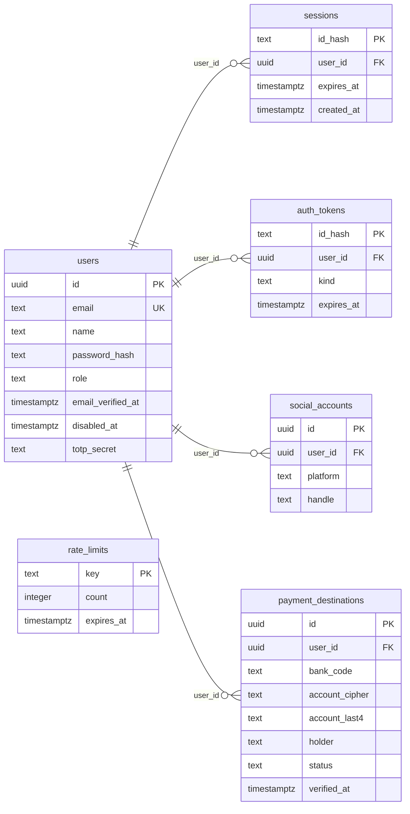
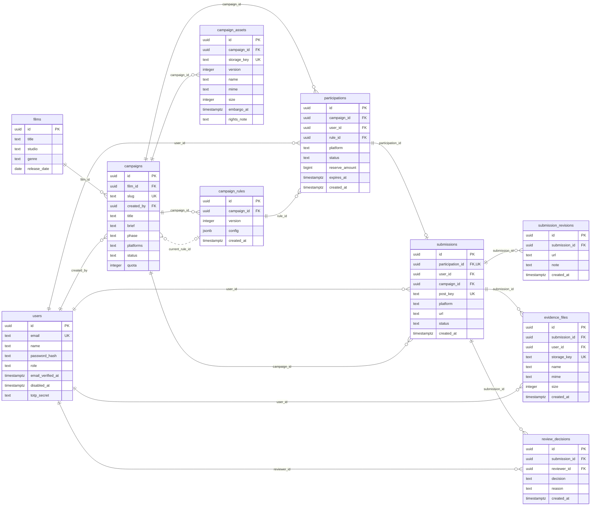
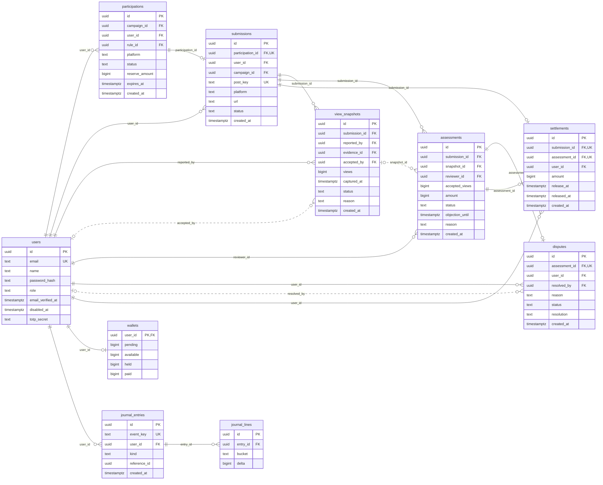
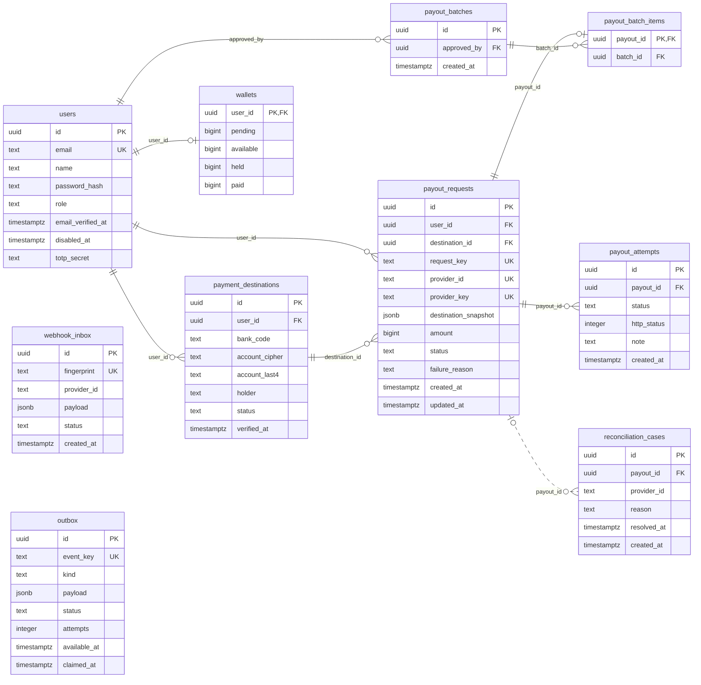
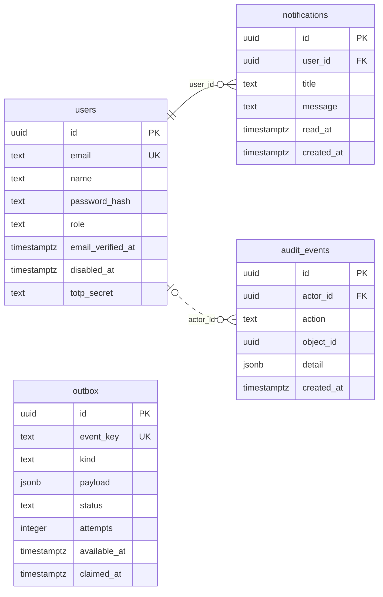

# ERD implementasi Sparksviu

Diagram diturunkan dari `migrations/001_core.sql` dan dibagi per domain agar bisa dibaca. Skema fisik ini memadatkan beberapa entitas konseptual pada ERD PRD: fase film menjadi atribut, varian tarif/tier menjadi JSONB tervalidasi, role menjadi enum aplikasi, budget reservation menyatu dengan participation, dan snapshot tujuan menyatu dengan payout. Tidak ada tabel fiktif untuk fitur yang belum dibangun.

## Identity

## Campaign

## Reward

## Payout

## Operations

## Invarian di luar gambar

- Partial unique index: satu assessment aktif per posting dan satu pencairan aktif per pengguna.
- Satu settlement per posting/assessment, satu post_key global, provider ID dan idempotency key unik.
- Wallet nonnegatif, reserved + spent <= budget.
- Tiap jurnal harus seimbang; mutasi saldo dan jurnal terjadi dalam transaksi yang sama.
- Relasi FK diagram tidak menggantikan pemeriksaan ownership dan peran pada layanan.
- `schema_migrations` dikelola runner migrasi dan tidak termasuk domain produk.
